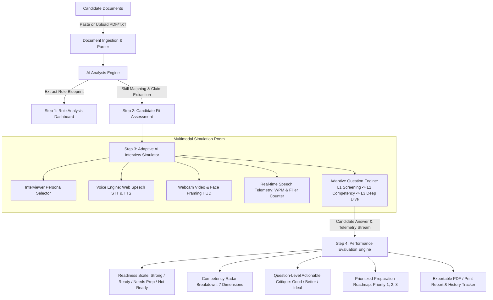

# 🎙️ Interview Accelerator — AI-Powered Personalized Interview Simulator & Prep Platform

[](https://studentcredibility.com)
[](https://react.dev/)
[](https://tailwindcss.com)
[](https://developer.mozilla.org/en-US/docs/Web/API/Web_Speech_API)
[](https://ai.google.dev/)

> **"If I can perform well here, I am genuinely prepared for my real interview."**  
> *A production-grade, multimodal interview simulation platform that parses real Job Descriptions and Resumes to conduct adaptive 3-level voice & video interviews, evaluate technical depth, and generate actionable preparation roadmaps.*

---

## 🌟 Executive Summary & Problem Solving (Student Credibility Context)

Candidates applying for jobs typically possess a **Resume** and a **Job Description (JD)**, yet they face critical blind spots:
1. **Uncertainty of employer expectations**: What core concepts and implicit requirements matter most?
2. **Resume-to-Job alignment opacity**: Which skills are strong matches versus missing or weak?
3. **Unpredictable interview questions**: Generic interview practice fails to probe the candidate's actual projects and quantitative claims.
4. **Lack of real-time conversational adaptability**: Standard prep apps ask static question lists without probing vague answers or testing edge cases.
5. **No actionable preparation roadmap**: Feedback is often vague ("improve your communication") instead of specific and technical ("quantify the 18% improvement baseline, implement cross-encoder reranking, and handle imbalanced evaluation metrics").

**Interview Accelerator** solves this end-to-end through a 4-step progressive experience:
- **Input (JD + Resume)**: Text or direct file upload (`.pdf`, `.docx`, `.txt`) with 1-click pre-loaded demo profiles (e.g. AI Engineer Intern).
- **Step 1 — Understand the Role**: Multi-dimensional JD extraction (Responsibilities, Required/Preferred Skills, Competencies, Core Concepts, Keywords).
- **Step 2 — Understand the Candidate & Job Fit**: Dynamic match percentage (e.g. 78%), Strong/Partial/Missing breakdown, and **Resume Claims to Probe** (identifying specific quantitative claims to challenge).
- **Step 3 — Adaptive Multi-Level Voice & Video AI Interview Room**: 3 progressive levels (Level 1: Screening ➔ Level 2: Competency ➔ Level 3: Deep-Dive Challenge) with real-time Speech-to-Text, natural Text-to-Speech, candidate webcam feed, AI video avatar, live WPM pace monitoring, and filler word detection.
- **Step 4 — Interview Performance Report & Actionable Roadmap**: Overall Score (0-100), Final Readiness Assessment (🟢 Strong Candidate, 🟡 Interview Ready, 🟠 Needs Preparation, 🔴 Not Ready), Competency Breakdown, Question-by-Question critique (What Was Good, What Could Be Better, Ideal Direction), and Prioritized Preparation Plans (Priority 1, 2, 3).

---

## 🚀 Live Demo & Quick Start

### 1. Prerequisites
- **Node.js**: v18.0+ (Tested on Node v25.8.0)
- **npm**: v9.0+

### 2. Local Setup

```bash
# Clone the repository
git clone https://github.com/your-username/interview-accelerator.git

# Navigate to project directory
cd interview-accelerator

# Install dependencies
npm install

# Launch development server
npm run dev
```

Open your browser at **`http://localhost:5173/`**.

### 3. Quick 1-Click Testing
You do not need to prepare files or enter an API key to experience the complete platform:
1. Click **⚡ Demo Presets** in the top navigation bar or select **🤖 AI Engineer Intern (Student Credibility)**.
2. Click **Start Role & Candidate Analysis**.
3. View **Role Analysis Dashboard** ➔ click **Proceed to Candidate Fit**.
4. View **Candidate Fit Score & Probe Claims** ➔ click **Launch AI Interview Simulator**.
5. Speak via microphone or type answers. Experience Level 1 (Screening) ➔ Level 2 (Competency) ➔ Level 3 (Deep-Dive).
6. Click **Generate Performance Report** to view the comprehensive score breakdown and study roadmap.
7. Click **Print / Save PDF** to export your shareable report!

---

## 🏛️ System Architecture



---

## 🧠 AI / LLM Approach & Dual-Engine Architecture

The platform is designed for zero-downtime reliability with a **Dual-Engine Architecture**:

1. **Live Gemini 2.5 Flash API Engine**:
   - Structured JSON schemas ensure strictly typed outputs for JD parsing, candidate alignment, dynamic follow-up generation, and question scoring.
   - Users can optionally enter their Gemini API Key via the secure key modal (persisted locally in browser `localStorage`).

2. **Intelligent Local AI Reasoning Engine (`MockAiEngine`)**:
   - Out of the box, if no API key is provided or if network latency occurs, the client-side heuristic engine parses project titles, numerical claims (e.g., `"improved accuracy by 18%"`), technical keywords, and candidate answers.
   - It simulates realistic AI interviewer logic with adaptive question selection, challenging edge-case counter-questions, and thorough multi-point evaluations.

---

## 🎙️ Voice & Video Implementation

### 1. Voice AI (Mandatory Requirement)
- **Speech-to-Text (STT)**: Integrated via `useSpeechRecognition` utilizing browser `webkitSpeechRecognition` / `SpeechRecognition` with continuous listening and live interim streaming.
- **Audio Amplitude Meter**: Real-time microphone volume tracking using Web Audio API `AudioContext` and `AnalyserNode` (FFT Size 64) for visual amplitude feedback.
- **Text-to-Speech (TTS)**: Built with `useSpeechSynthesis` featuring natural voice selection, pitch/rate controls matching interviewer personas, and real-time `isSpeaking` states.
- **Audio-Reactive Avatar**: AI interviewer avatar pulses with animated soundwave visualizers during question speech.

### 2. Video Experience (Bonus Requirement)
- **Candidate Video Stream**: Live local webcam feed with center face framing guide and privacy camera toggle (`Video` / `VideoOff`).
- **Telemetry HUD**:
  - **Speaking Pace (WPM)**: Real-time calculation (`words / elapsed minutes`) categorized into *Deliberate*, *Optimal Conversational (120-155 WPM)*, or *Fast-Paced*.
  - **Filler Word Detection**: Live scanning for speech artifacts (`um`, `uh`, `like`, `basically`, `actually`, `you know`, `sort of`, `literally`).
  - **Response Duration**: Dedicated timer per question turn.

---

## 🔄 Dynamic Questioning & 3-Level Progression Logic

The interview experience is never a static questionnaire. It follows three progressive levels:

### Level 1 — Screening Interview
- Dynamically greets the candidate and anchors questions to their **specific project** (e.g. *"I noticed you worked on the RAG Academic Research Assistant capstone. Could you explain the core problem it solved and your specific contribution?"*).
- Evaluates communication clarity, motivation, and role alignment.

### Level 2 — Competency Interview
- Tests job-specific technical competencies (e.g. chunking strategies, vector search latency trade-offs, async FastAPI concurrency, and WebSocket backpressure).
- Adapts follow-ups based on the candidate's stated architectural decisions.

### Level 3 — Deep-Dive Interview (High Challenge)
- **Simulates a demanding lead interviewer**:
  - Probes specific numerical resume claims (e.g. *"You mentioned improving model accuracy by 18%. How did you establish your baseline and ground truth, and how would you evaluate under severe class imbalance?"*).
  - Challenges vague answers and introduces failure modes (e.g. streaming client disconnects, hallucination guardrails, memory leaks).

---

## 📊 Evaluation Methodology & Performance Report

The evaluation produces actionable, recruiter-grade insights:

1. **Overall Score (0-100)**: Weighted composite of question technical depth, precision, STAR structure, and delivery fluency.
2. **Readiness Level**:
   - 🟢 **Strong Candidate** (Score ≥ 85): Demonstrates strong readiness, domain depth, and structured reasoning.
   - 🟡 **Interview Ready** (Score 72-84): Can reasonably attempt the interview; minor edge-case gaps.
   - 🟠 **Needs Preparation** (Score 58-71): Important gaps in quantitative metrics and architecture trade-offs.
   - 🔴 **Not Ready** (Score < 58): Significant preparation required across core fundamentals.
3. **Competency Scores**: Evaluates Role Fit, Technical Knowledge, Problem Solving, Communication, Confidence, Depth of Understanding, and Behavioural Fit.
4. **Question-Level Feedback**: For each turn:
   - **Question Asked & Candidate Spoken Answer**
   - **Assessment & Numerical Score**
   - **What Was Good**: Specific concrete strengths.
   - **What Could Be Better**: Actionable critique (avoids generic feedback).
   - **Ideal Direction**: Step-by-step model answer structure.
5. **Prioritized Preparation Plan**:
   - **Priority 1, 2, 3 Topics** with concrete concept checklists (e.g., Chunking, Embeddings, RRF Reranking, Vector DB indexing, STAR framework) and practice prompts.

---

## 🛠️ Key Technical Decisions & Stack

| Area | Technology | Rationale |
| :--- | :--- | :--- |
| **Framework** | React 19 + TypeScript + Vite | Ultra-fast HMR, strict type safety, zero build latency. |
| **Styling** | TailwindCSS v4 + Custom Glassmorphism | Premium dark-mode UI with silky micro-animations, glowing borders, and print styles. |
| **Icons** | Lucide React | Modern, consistent iconography for tech cards and telemetry. |
| **File Parsing** | `pdfjs-dist` + HTML5 FileReader | Direct client-side PDF text extraction without requiring external backend servers. |
| **Voice / Video** | Web Speech API + Web Audio API + MediaDevices | Sub-millisecond latency voice recognition and native browser video rendering. |
| **AI Integration** | Google Gemini API + Offline Fallback Engine | High availability and instant testability under any environment. |
| **Celebration** | Canvas Confetti | Visual positive reinforcement for interview readiness milestones. |

---

## 📂 Project Structure

```
interview-accelerator/
├── index.html                   # HTML entry point with Google Fonts & SEO metadata
├── package.json                 # Dependencies & scripts
├── tsconfig.json                # TypeScript configuration
├── vite.config.ts               # Vite configuration with Tailwind v4 plugin
├── src/
│   ├── main.tsx                 # React application mount
│   ├── App.tsx                  # Master application orchestrator & state manager
│   ├── index.css                # Design system tokens, glassmorphism & waveform keyframes
│   ├── types.ts                 # TypeScript type definitions across all 4 steps
│   ├── data/
│   │   └── presets.ts           # Pre-loaded profiles (AI Engineer, Full-Stack, PM) & Personas
│   ├── utils/
│   │   └── fileParser.ts        # PDF/Doc parser, filler word detector & speech telemetry
│   ├── services/
│   │   ├── geminiService.ts     # Google Gemini API client with structured prompts
│   │   ├── mockAiEngine.ts      # Client-side heuristic reasoning & evaluation engine
│   │   └── aiService.ts         # Unified AI routing service with automatic fallback
│   ├── hooks/
│   │   ├── useSpeechRecognition.ts # Speech-to-text with live audio amplitude analyzer
│   │   └── useSpeechSynthesis.ts   # Text-to-speech with persona voice controls
│   └── components/
│       ├── Navbar.tsx           # Navigation header, demo presets & step breadcrumbs
│       ├── InputSection.tsx     # Step 0: Job Description & Resume upload / paste
│       ├── RoleAnalysisView.tsx # Step 1: Understand the Role Dashboard
│       ├── CandidateFitView.tsx # Step 2: Understand Candidate & Job Fit Assessment
│       ├── VideoRoom.tsx        # Multimodal video room with webcam & AI avatar HUD
│       ├── InterviewSimulator.tsx # Step 3: Multi-level adaptive interview orchestrator
│       ├── PerformanceReportView.tsx # Step 4: Comprehensive scoring & study roadmap
│       ├── ApiKeyModal.tsx      # Gemini API key configuration modal
│       └── HistoryModal.tsx     # Saved past interview reports viewer
```

---

## 📄 License & Attribution

Built for the **AI Product Engineer Intern — Interview Accelerator Challenge (Assignment 3)**. Aligned with [Student Credibility](https://studentcredibility.com).
